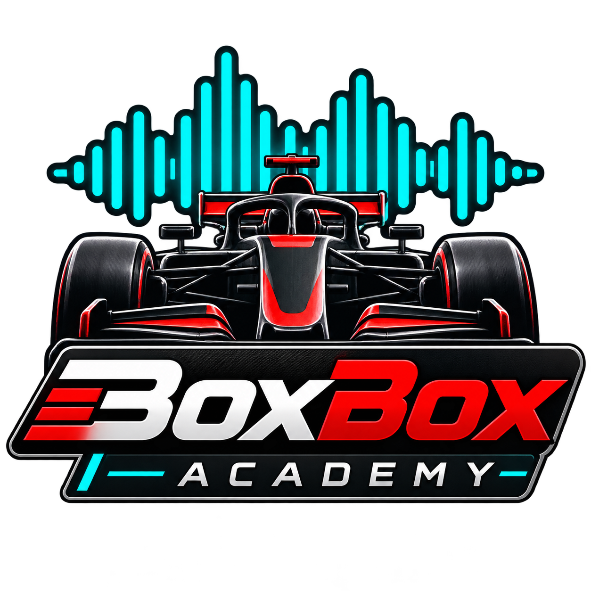

<p align="center"></p>

# BoxBox Academy

Aplikacja PC w Pythonie, która odbiera telemetrię UDP z F1 25 i mówi do gracza
głosem mechanika-instruktora. Tryb nauki uczy jazdy bez asyst, tryb wyścigowy
pełni rolę inżyniera na radiu. Plan realizacji: [PLAN.md](PLAN.md).

## Szybki start

```
pip install -e .[dev]
pytest
python -m boxbox.app --mode coach                  # na żywo z grą (UDP 20777)
python -m boxbox.app --replay recordings/<plik>    # z nagrania
python -m boxbox.telemetry.record --name <tor>     # nagrywanie sesji
```

Instrukcja nagrywania sesji: [docs/NAGRANIA.md](docs/NAGRANIA.md).
Paczka dla nagrywającego (PDF + recorder): `python tools/build_recorder_package.py` → `dist/`.
